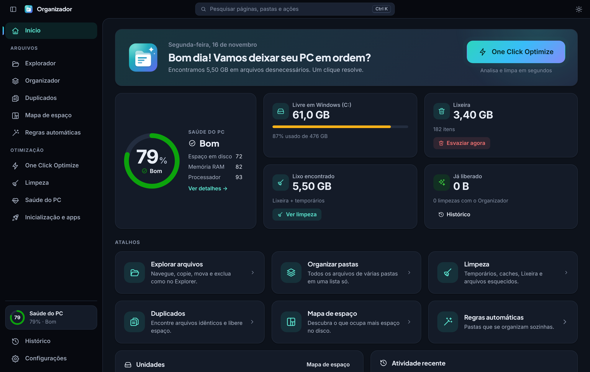
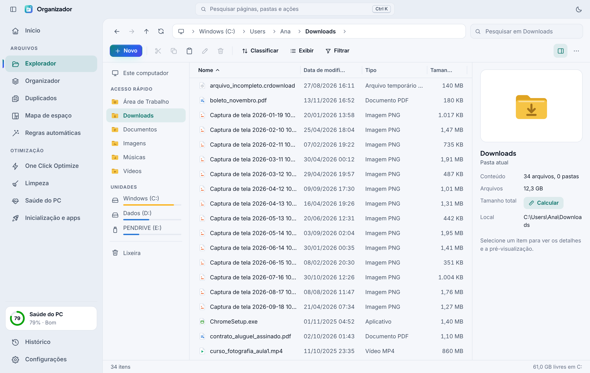
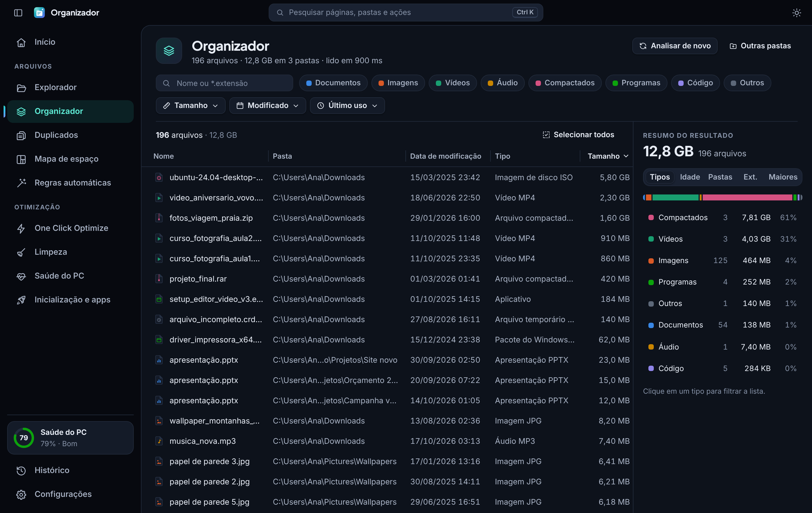
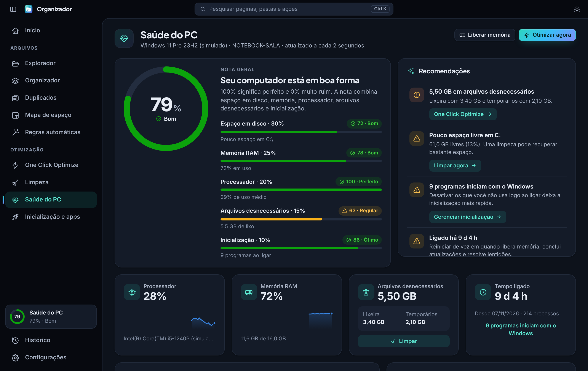
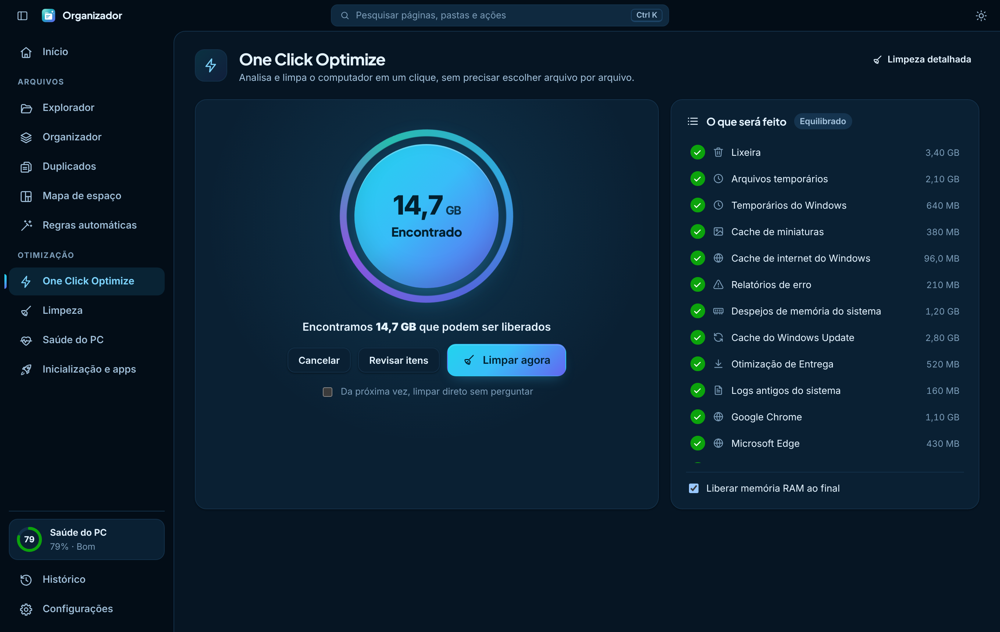
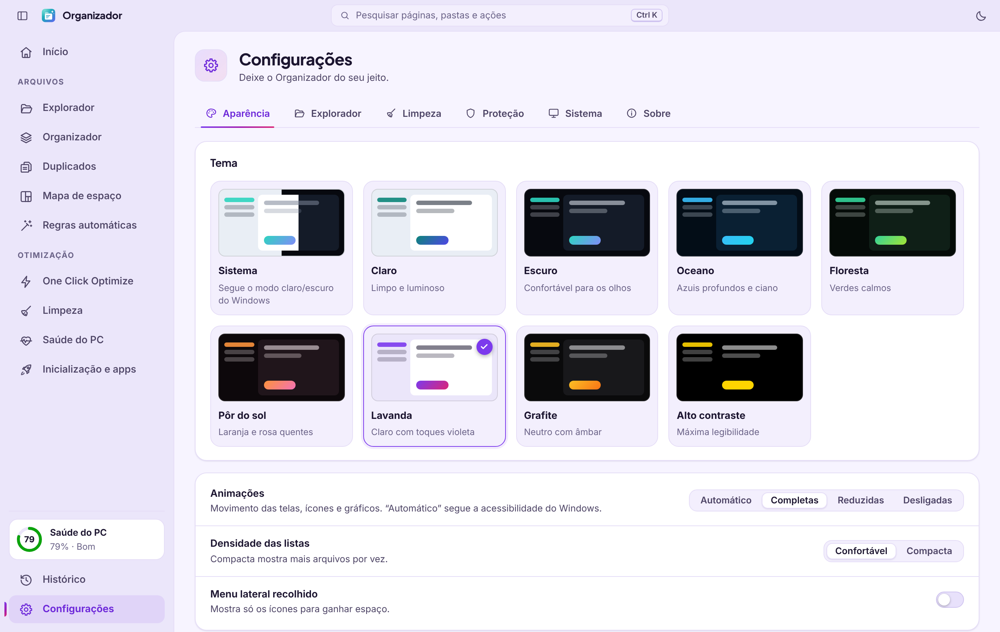

<p align="center">
  
</p>

<h1 align="center">Organizador</h1>

<p align="center">
  Explorador de arquivos para Windows com foco em <strong>organização, limpeza e otimização</strong>.<br/>
  Funciona 100% off-line — nenhum dado sai do seu computador.
</p>

<p align="center">
  
</p>

## O que ele faz

### Arquivos
- **Explorador completo**, igual ao do Windows: Este computador, Acesso rápido, Favoritos e unidades; barra de endereço clicável e editável; voltar, avançar e pasta acima; modos Detalhes e Ícones grandes com miniaturas; painel de detalhes com pré-visualização de imagens e textos.
- **Copiar, recortar, colar, renomear, excluir** (para a Lixeira ou permanentemente), nova pasta e novo documento de texto, com os mesmos atalhos do Explorer (Ctrl+C/X/V, Delete, Shift+Delete, F2, Ctrl+Shift+N, Alt+setas, F5, Ctrl+L…). A área de transferência é compatível com o Explorer do Windows, então dá para copiar num e colar no outro.
- **Filtros por coluna como no Explorer**: Nome (A–H, I–P, Q–Z), Data (Hoje, Ontem, Semana passada… Há muito tempo), Tipo e Tamanho (Vazio, Minúsculo, Pequeno, Médio, Grande, Enorme, Gigantesco), além de ordenação natural (foto2 antes de foto10).
- **Arrastar e soltar** entre pastas (Ctrl copia), inclusive arquivos vindos do Windows.
- **Desfazer (Ctrl+Z)** para mover, copiar, renomear, criar e excluir para a Lixeira.
- **Organizador “destrinchado”**: escolha várias pastas e veja todos os arquivos de todas as subpastas numa lista única (aguenta centenas de milhares), com filtros por tipo, tamanho, data e último uso, resumo por tipo, idade, pasta e extensão, e ações em lote.
- **Duplicados** pelo conteúdo (BLAKE3), com seleção automática que sempre mantém uma cópia.
- **Mapa de espaço** (treemap) para ver de relance o que ocupa o disco.
- **Regras automáticas**: “organizar Downloads por tipo”, “fotos por ano e mês”, “instaladores antigos para a Lixeira”… com prévia antes de aplicar e Desfazer.

### Limpeza e otimização
- **One Click Optimize**: analisa e limpa em um clique, com perfis Seguro, Equilibrado, Completo e Personalizado, liberação de RAM e nota de saúde antes e depois.
- **Limpeza do sistema** com prévia: Lixeira, temporários do usuário e do Windows, caches de Chrome, Edge, Brave, Opera e Firefox, caches de apps (Discord, Teams, Slack, VS Code, Spotify, Steam), miniaturas, relatórios de erro, despejos de memória, cache do Windows Update, logs antigos, downloads incompletos ou esquecidos, instaladores antigos e pastas vazias.
- **Arquivos esquecidos**: o que você não usa há meses ou anos, para arquivar ou excluir.
- **Lixeira**: ver o conteúdo, restaurar, excluir definitivamente ou esvaziar de uma vez.
- **Limpeza automática** diária, semanal ou mensal (nunca toca em arquivos pessoais).
- **Inicialização**: ativar ou desativar programas que iniciam com o Windows (compatível com o Gerenciador de Tarefas).
- **Programas instalados**: lista com tamanho e data, e desinstalação pelo desinstalador oficial.

### Saúde do PC
- Nota geral de **0 a 100%** (100% = Perfeito, 0% = Muito ruim!), ponderada entre espaço em disco (30%), memória (25%), processador (20%), arquivos desnecessários (15%) e inicialização (10%).
- Gráficos ao vivo de CPU e memória, discos internos e externos, bateria (incluindo desgaste em notebooks), programas que mais consomem (com “Encerrar”) e recomendações com um botão para resolver cada uma.

### Visual
- Logo e identidade próprias, ícones SVG desenhados para o app (vários animados), transições entre telas e respeito à preferência de movimento reduzido do Windows.
- **8 temas + Sistema**: Claro, Escuro, Oceano, Floresta, Pôr do sol, Lavanda, Grafite e Alto contraste (contraste de texto conferido pelo critério WCAG AA).
- Paleta de comandos (**Ctrl+K**) para ir a qualquer tela, pasta ou ação.

## Telas

<table>
  <tr>
    <td width="50%"><br/><sub>Explorador (tema Claro)</sub></td>
    <td width="50%"><br/><sub>Organizador: três pastas destrinchadas numa lista só</sub></td>
  </tr>
  <tr>
    <td><br/><sub>Saúde do PC</sub></td>
    <td><br/><sub>One Click Optimize (tema Oceano)</sub></td>
  </tr>
  <tr>
    <td colspan="2"><br/><sub>Temas (Lavanda selecionado)</sub></td>
  </tr>
</table>

<sub>As capturas usam o disco simulado do modo de desenvolvimento (<code>npm run dev</code>), com a usuária fictícia “Ana”.</sub>

## Segurança

- Exclusões vão para a **Lixeira** por padrão; excluir permanentemente sempre pede confirmação.
- Toda limpeza mostra uma **prévia** do que será apagado.
- O app **nunca** exclui, move ou renomeia a pasta do Windows, as raízes das unidades (C:\, D:\…), Arquivos de Programas, a pasta de usuários e as suas pastas pessoais principais.
- Você pode marcar **pastas protegidas** nas Configurações: nada dentro delas é tocado.
- Processos essenciais do Windows não podem ser encerrados pelo app.

## Instalação

Os instaladores são gerados automaticamente pelo GitHub Actions a cada envio de código:

1. Abra a aba **Actions** do repositório, entre na execução mais recente de *“Windows — testes e instalador”* e baixe o artefato **Organizador-instaladores-windows**. Versões marcadas com tag (`v1.0.0`, por exemplo) também aparecem em **Releases**.
2. Escolha um dos dois:
   - `Organizador-Setup.exe` — leve. Usa o WebView2, que já vem no Windows 10 e 11 atualizados.
   - `Organizador-Setup-Offline.exe` — maior, com o WebView2 embutido. Instala sem internet em qualquer computador.
3. Execute e clique em **Avançar → Instalar**. Não é preciso ser administrador.

> O instalador não é assinado digitalmente, então o Windows pode mostrar “O Windows protegeu o computador”. Clique em **Mais informações → Executar assim mesmo**.

Algumas limpezas do sistema (Windows\Temp, cache do Windows Update) e itens de inicialização de todos os usuários pedem o app como administrador. Há um botão **Reiniciar como administrador** onde isso é necessário.

## Desenvolvimento

Requisitos: [Node.js 22](https://nodejs.org), [Rust estável](https://rustup.rs) e os [pré-requisitos do Tauri 2](https://tauri.app/start/prerequisites/) (no Windows, Microsoft C++ Build Tools e WebView2).

```bash
npm install            # dependências
npm run tauri dev      # app completo com recarga automática
npm run dev            # só a interface no navegador, com um disco simulado
npm run typecheck      # TypeScript
npm run lint           # ESLint
npm test               # testes da interface (Vitest)
npm run test:rust      # testes do núcleo em Rust
npm run tauri build    # instalador NSIS em src-tauri/target/release/bundle/nsis
npm run icons          # regenera ícones e imagens do instalador a partir de brand/logo.svg (requer Playwright)
```

No navegador (`npm run dev`) o app usa um backend simulado (`src/lib/mock*.ts`) com um disco fictício, útil para trabalhar no visual sem o Windows.

### Estrutura

```
brand/                 Logo (SVG mestre)
docs/capturas/         Capturas de tela
scripts/gen-icons.mjs  Gera ícones (.ico/.png) e imagens do instalador
src/                   Interface (React + TypeScript)
  components/          Componentes visuais (ícones, tabela, gráficos, menus…)
  lib/                 API, filtros, formatação, nota de saúde, operações de arquivo
  pages/               Telas (Início, Explorador, Organizador, Limpeza, Saúde…)
  store/               Estado (Zustand), com configurações persistidas
  styles/              Tokens de tema e estilos
src-tauri/             Aplicativo Tauri (comandos, janela, instalador)
  core/                Núcleo em Rust, sem dependência do Tauri: arquivos, varredura,
                       consultas, limpeza, duplicados, mapa, regras, saúde e Windows
.github/workflows/     CI que testa no Windows e gera os instaladores
```

## Tecnologias

[Tauri 2](https://tauri.app) e Rust (Rayon, BLAKE3, sysinfo, trash, windows-sys, winreg) no núcleo; React 19, TypeScript, Vite, Zustand, Motion e TanStack Virtual na interface. Fontes Inter e Plus Jakarta Sans embutidas, sem nada carregado da internet.
